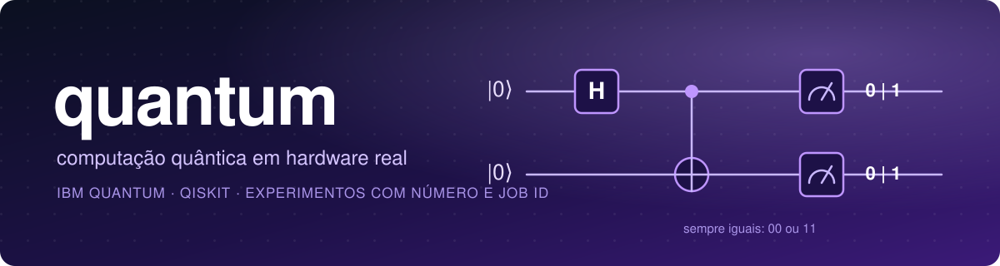

<div align="center">



<br>


**Um caderno de laboratório aberto: cada experimento roda em chip quântico de verdade, com número, job ID e a conta de quanto deu errado.**

</div>

---

## 🔬 Experimentos

| # | Experimento | O que mostra | Chip | Resultado | Estado |
|:-:|:--|:--|:--|:--|:-:|
| 01 | [**Estado de Bell**](experimentos/01-bell) | Emaranhamento de 2 qubits | `ibm_marrakesh` | **98,54%** em `00` ou `11` | ✅ |
| 02 | Estado GHZ | Emaranhar 3 ou mais qubits e ver o ruído crescer | | | 🔜 |
| 03 | Grover | Busca com ganho quadrático em 2 a 3 qubits | | | 🔜 |
| 04 | Mitigação de erro | Quanto dos erros dá para recuperar por software | | | 🔜 |
| 05 | Mesmo circuito, dois chips | Ruído é do circuito ou do chip? | | | 🔜 |

> Só entra na tabela o que foi **medido**. As linhas 🔜 são o plano, sem número até rodar.

## 🧭 Por que isto existe

Computação quântica é cercada de promessa e de poucos números. Aqui o caminho é o contrário: pegar o hardware que a IBM oferece de graça, rodar coisa pequena e **registrar tudo**, inclusive o erro. Onde computadores quânticos prometem ganho real:

- 🧬 **Simular moléculas e materiais**, a aplicação mais sólida
- 🔑 **Fatorar números grandes** (Shor), que ameaça a criptografia atual a longo prazo
- 🔎 **Busca e otimização**, com ganho comprovado em alguns casos e ainda em debate em outros

Com as máquinas de hoje (ruidosas, com poucos qubits utilizáveis) nada disso funciona em escala útil. Os experimentos daqui são degraus.

## 🚀 Rodar

Você precisa de uma conta gratuita na [IBM Quantum Platform](https://quantum.cloud.ibm.com) e de uma chave de API.

```bash
git clone https://github.com/thiagopatzdorf/quantum.git
cd quantum

python -m venv .venv && source .venv/bin/activate
pip install -r requirements.txt

export IBM_QUANTUM_TOKEN="sua-chave-aqui"   # nunca commite isto
cd experimentos/01-bell && python bell.py
```

> 🔐 **A chave nunca entra no repositório.** O código só lê `IBM_QUANTUM_TOKEN` do ambiente, e o `.gitignore` bloqueia `.env`.

## 📐 Regras da casa para um experimento

Cada experimento vive em `experimentos/NN-nome/` e entrega quatro coisas:

1. **Um script** que lê a chave do ambiente e roda de ponta a ponta.
2. **Os dados brutos** em `resultados/*.json`, com o `job_id` da IBM para qualquer um conferir.
3. **Um README** com o circuito, a tabela de contagens e uma seção **"o que isto prova, e o que não prova"**.
4. **Uma frase sem enfeite** no índice acima, e só depois de medido.

Frase sem número é hipótese. Ruído é dado, não vergonha. O código fica como foi rodado.

## 🛠️ Stack

[Qiskit](https://www.ibm.com/quantum/qiskit) · [Qiskit IBM Runtime](https://github.com/Qiskit/qiskit-ibm-runtime) · Python 3.12 · plano **Open** da IBM Quantum (gratuito, com cota mensal de tempo de execução)
