# 01 · Estado de Bell

O "olá, mundo" do emaranhamento: dois qubits, duas portas, e um resultado que nenhum computador comum reproduz *por construção*, só por simulação.

<div align="center">
  
</div>

## O circuito

```text
     ┌───┐     ┌─┐
q_0: ┤ H ├──■──┤M├───
     └───┘┌─┴─┐└╥┘┌─┐
q_1: ─────┤ X ├─╫─┤M├
          └───┘ ║ └╥┘
c: 2/═══════════╩══╩═
                0  1
```

1. **H (Hadamard)** coloca o qubit 0 em superposição: 50% `0`, 50% `1`.
2. **CNOT** amarra o qubit 1 ao 0: ele inverte quando o 0 vale `1`.
3. **Medimos** os dois.

Num computador perfeito só pode sair `00` ou `11`. Os dois qubits estão emaranhados: sempre concordam, mesmo sem nenhum deles ter valor definido antes da medição.

## Resultado medido no chip real

| | |
|:--|:--|
| **Chip** | `ibm_marrakesh` (156 qubits), escolhido como o menos ocupado na hora |
| **Quando** | 2026-10-04, 04:38 UTC |
| **Medições** | 1024 |
| **Job na IBM** | `db0tf63id5ic73eqaf90` |

| Resultado | Contagens | Fração | Leitura |
|:---------:|----------:|-------:|:--------|
| `00` | 520 | 50,78% | ✅ esperado |
| `11` | 489 | 47,75% | ✅ esperado |
| `01` | 8 | 0,78% | ⚠️ ruído |
| `10` | 7 | 0,68% | ⚠️ ruído |

**98,54%** das medições concordaram entre si. Os **1,46%** restantes são o que o hardware real erra: decoerência, imperfeição nas portas e erro de leitura. Num simulador ideal esse número seria 0%, e é justamente essa diferença que torna interessante rodar no chip de verdade.

Dados brutos: [`resultados/bell.json`](resultados/bell.json) · circuito: [`resultados/circuito.txt`](resultados/circuito.txt)

## Rodar

```bash
export IBM_QUANTUM_TOKEN="sua-chave-aqui"   # nunca commite isto
cd experimentos/01-bell
python bell.py --shots 1024
```

O script escolhe o chip menos ocupado, manda o job, espera na fila e grava `resultados/bell.json`, `resultados/circuito.txt` e `resultados/bell.png`. Cada execução cai em outro chip, em outro momento, então os números mudam um pouco; a fração perto de 98% a 99% é o que se espera.

## O que isto prova, e o que não prova

- ✅ O acesso ao hardware real funciona de ponta a ponta (conta, fila, job, resultado).
- ✅ Dá para ver emaranhamento e ruído numa medição real.
- ❌ **Não** é vantagem quântica: um computador comum simula 2 qubits sem esforço.
- ❌ Uma rodada só não mede a taxa de erro do chip. Para isso seria preciso repetir em horários e chips diferentes.

## Nota técnica

Com `qiskit-ibm-runtime` 0.50 o `SamplerV2` já aparece como deprecado. Funciona, e o código está como foi rodado; a troca fica para quando a versão nova estabilizar.
